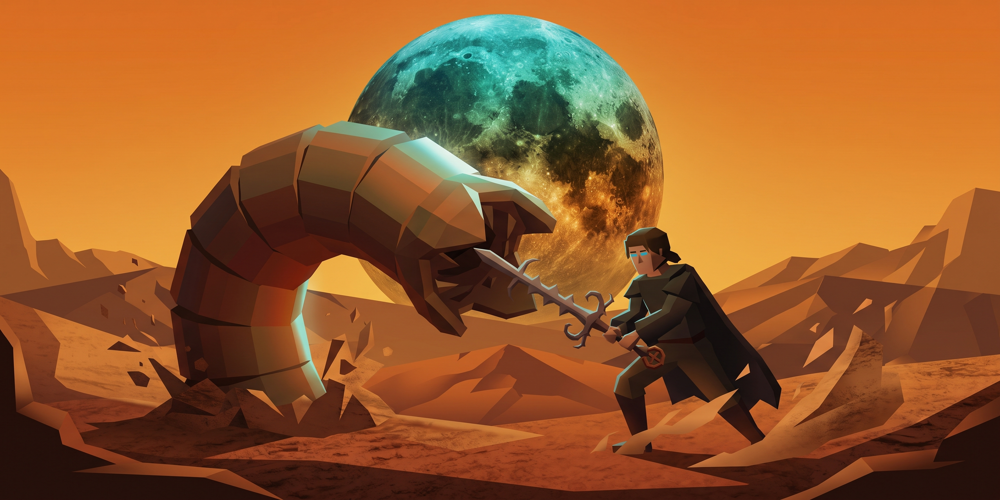

# Dunescape

An elegant, atmospheric dark theme for [Omarchy](https://omarchy.org/) Linux inspired by the iconic vintage cover of Frank Herbert's *Dune*.

Featuring deep obsidian-brown cloak surfaces, sun-bleached desert sand typography, glowing spice-blue accents, and a radiant amber sun-halo border.



## Features

- **Contrast-Engineered:** 13.69:1 foreground/background contrast ratio for readability.
- **Full Omarchy Integration:** Automatically styles Hyprland window borders, Omarchy Quickshell bar, terminals (Ghostty, Kitty, Alacritty, Foot), Neovim, btop, VS Code, and more.
- **Active Halo Rim:** Features radiant desert amber-orange active window borders (`#e07b22`).
- **High-Resolution Wallpaper Included:** Bundled with a 2880×1440 background.

## Installation

### Via Terminal
Run the following command:

```bash
omarchy theme install https://github.com/val-27/omarchy-dunescape-theme.git
```

Omarchy will automatically clone the repository, strip prefixes, and register the theme cleanly as `dunescape`.

### Via Omarchy Menu
1. Press `Super + Alt + Space` (or open the Omarchy launcher).
2. Navigate to **Install** → **Style** → **Themes**.
3. Paste: `https://github.com/val-27/omarchy-dunescape-theme.git`

## Applying the Theme

Once installed, switch to Dunescape anytime with:

```bash
omarchy theme set dunescape
```

Or select it interactively:

```bash
omarchy theme switcher
```

## Color Palette

| Name | Role | Hex | Preview |
| :--- | :--- | :--- | :---: |
| **Background** | Deep Cloak Obsidian | `#140a08` | `■` |
| **Lighter Background** | Card & Popup Surface | `#241310` | `■` |
| **Foreground** | Desert Sand Typography | `#f5d496` | `■` |
| **Bright Foreground** | Sun-Bleached Sand Crest | `#fae8c6` | `■` |
| **Active Border** | Radiant Sun Halo Rim | `#e07b22` | `■` |
| **Accent / Cyan** | Title Celestial Teal | `#19a7a6` | `■` |
| **Cursor / Bright Blue** | Glowing Spice Eyes | `#1fc8db` | `■` |
| **Selection** | Deep Rust Shadow | `#3f1c13` | `■` |
| **Muted** | Nightstone / Comments | `#4a2820` | `■` |
| **Red** | Sunburst Burnt Rust | `#b53b1b` | `■` |
| **Yellow / Orange** | Spice Amber Glow | `#d97a1e` | `■` |
| **Green** | Planetary Teal | `#1d8e87` | `■` |
| **Blue** | Deep Turquoise Shadow | `#14859d` | `■` |
| **Magenta** | Warm Terracotta | `#8c382b` | `■` |

## License

[MIT](LICENSE)
